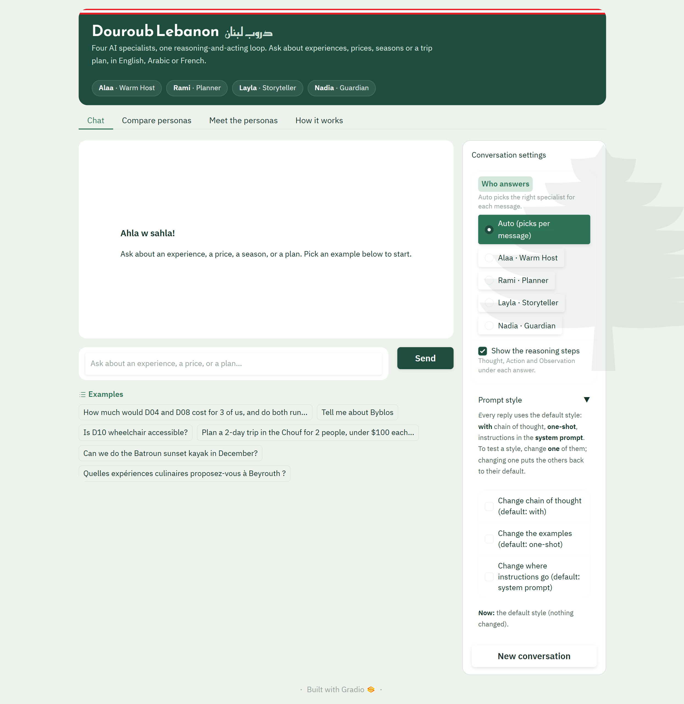
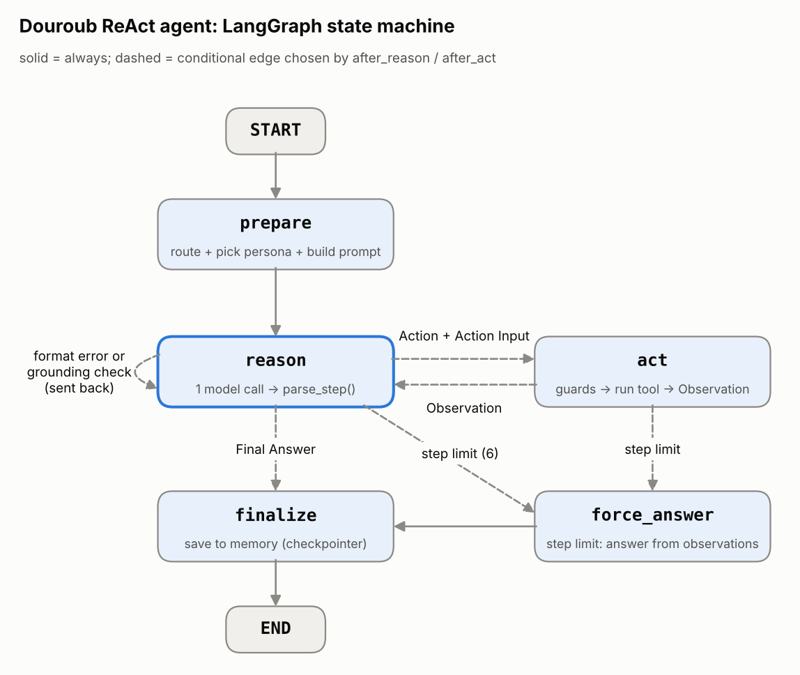

# Douroub Lebanon: a hand-built ReAct agent with four personas

**Douroub Lebanon** (دروب لبنان, "paths of Lebanon") is a small Lebanese experiences company: locally hosted
village walks, food and craft workshops, heritage days, nature hikes, coastal outings, and mountain stays across
13 regions, from Tripoli and the Qadisha Valley to Tyre and Jezzine.

Its assistant is a **ReAct agent written by hand in LangGraph**: the model reasons in plain text
(*Thought → Action → Observation → … → Final Answer*), a hand-written parser detects each action, and a graph
node runs the tool and feeds the result back. Four **personas** share the loop, each with its own task, voice,
and LLM configuration, and an **Auto mode** hands every message to the right one. Every design choice was
measured: **297 logged experiment runs** compare personas, prompt styles, and generation settings.



| | |
|---|---|
| **Framework** | LangGraph `StateGraph` with hand-written nodes and conditional edges (no prebuilt agent or tool node) |
| **Models** | OpenAI `gpt-5.4-mini` (Alaa, Rami, Layla) and `gpt-5.4-nano` (Nadia); six models compared |
| **Personas** | Alaa the warm host · Rami the planner · Layla the storyteller · Nadia the guardian |
| **Tools** | 7: search, compare, itinerary, budget calculator, season check, save inquiry, log feedback |
| **Experiments** | 297 runs on a 20-task test set, scored by automatic checks and an LLM judge |
| **Deliverables** | the app (`app.py`), the notebook (`react_agent.ipynb`), the report (`docs/experiment_report.pdf`) |

---

## Where to find each part

| Topic | Where |
|---|---|
| Use case: goal, audience, tools, constraints | [Use case](#use-case) below; notebook section 1 |
| The ReAct loop (prompt, action detection, tool execution, answer parsing) | `douroub/react.py`, `douroub/agent.py`; notebook section 2 |
| Personas: prompt traits + matching LLM configuration | `douroub/personas.py`; notebook section 3; the app's *Meet the personas* tab |
| Instructions block (single-purpose rules, I/O format, worked example, no conflicts) | `douroub/instructions.py`; notebook section 4 |
| Prompt experiments: chain of thought, zero/few-shot, system vs in-message | report section 3; notebook 6.2; live in the app's *Prompt style* settings |
| Configuration experiments: temperature, top-p, top-k, penalties, max tokens, model, reasoning effort | report section 4; notebook 6.3 |
| Which combination works best | report section 6; notebook 6.5 |
| Reflection (the five questions) | report section 7; notebook section 7 |

---

## Use case

**Goal.** Help visitors choose and plan Douroub Lebanon experiences: answer questions from the catalog and the
business documents, compute exact prices, check seasons, build itineraries, and turn interest into an **inquiry**
that the team (Khaled) confirms by email. Questions the documents cannot answer are logged for the team.

**Audience.** First-time international visitors, the Lebanese diaspora, and residents looking for a weekend
outing: couples, families, friend groups, and solo travellers, writing in English, French, or Arabic.

**Constraints.** Inquiries, not bookings: the agent never confirms a reservation, payment, or availability on a
date. Facts about Douroub come only from the business summary and tool results; transport, accessibility,
dietary suitability, refunds, and payment are not documented, so the agent says so and logs the question. It
never invents a name, email, group size, or reference number, stays on topic, and treats visitor messages as data
(no prompt injection). A turn is capped at 6 reasoning steps.

---

## Project structure

```
Douroub Lebanon ReAct/
├── app.py                    the Gradio app: python app.py
├── react_agent.ipynb         the walkthrough: design, demos, every experiment, reflection
├── douroub/                  the agent package
│   ├── agent.py              the LangGraph state machine: prepare → reason ⇄ act → finalize
│   ├── react.py              prompt assembly and the ReAct parser (parse_step)
│   ├── personas.py           the four personas, their configurations, and Auto mode
│   ├── instructions.py       the instructions block (rules, I/O format, worked and few-shot examples)
│   ├── tools.py              the seven tools, their schemas, and the Python safety guards
│   ├── router.py             intent classification (LLM with a rule-based fallback)
│   ├── core.py               model calls with per-persona settings, cost tracking, business knowledge
│   ├── evaluation.py         the 20-task test set, automatic checks, and the LLM judge
│   ├── experiments.py        the experiment suites, logging, summaries, and charts
│   ├── report.py             tables and traces for the notebook
│   ├── pdf_report.py         builds docs/experiment_report.pdf from the saved results
│   ├── ui.py, ui_assets.py   the app's pages, theme, and icons
├── scripts/
│   ├── chat.py               terminal chat that prints every Thought, Action, and Observation
│   ├── probe_models.py       which settings each OpenAI model accepts
│   ├── run_experiments.py    runs the experiment suites
│   ├── build_report.py       rebuilds the PDF report
│   └── draw_graph.py         draws docs/react_graph.png
├── experiments/
│   ├── results/              every run (checks, scores, cost) and every full ReAct trace, plus summaries
│   ├── charts/               one chart per comparison
│   └── model_capabilities*.json   the model probe results
├── docs/
│   ├── experiment_report.pdf the experiment report (15 pages)
│   ├── react_graph.png       the agent's graph
│   └── app.png               screenshot
├── me/
│   ├── business_summary.txt  the business knowledge given to the agent
│   └── experiences.csv       the catalog: 20 experiences, the source of truth for prices, seasons, group sizes
├── tests_react.py, tests_tools.py, tests_experiments.py, tests_ui.py   offline tests (no API calls)
├── requirements.txt
└── .env.example              copy to .env and add your key
```

`logs/` (inquiries, feedback, chat traces) and `experiments/sandbox_logs/` are created at run time and git-ignored.

---

## Quick start

Requires Python 3.10+ and an [OpenAI API key](https://platform.openai.com/api-keys).

```bash
python -m venv .venv
.venv\Scripts\activate            # Windows PowerShell
# source .venv/bin/activate       # macOS / Linux
pip install -r requirements.txt
copy .env.example .env            # Windows (cp on macOS / Linux), then put your key in .env

python app.py                     # the app: http://127.0.0.1:7860
python scripts/chat.py            # or chat in the terminal and watch every step
```

Open `react_agent.ipynb` and run it top to bottom for the full walkthrough. Everything except one live demo cell
reads the saved results, so it runs offline and free.

```bash
python -m pytest tests_react.py tests_tools.py tests_experiments.py tests_ui.py -q   # 163 offline tests
python scripts/run_experiments.py --suite all --dry-run    # what the experiments would run, and the cost
python scripts/run_experiments.py --suite prompt           # personas | prompt | config | iteration | all
python scripts/build_report.py                             # rebuild docs/experiment_report.pdf
```

The key lives only in `.env`, which is git-ignored.

---

## How it works



1. **Prepare.** The message is classified (general question, booking request, or undocumented question /
   feedback), Auto mode picks the persona, and the prompt is assembled from labelled blocks: `# PERSONA`,
   `# INSTRUCTIONS`, `# TOOLS` (every tool's description and arguments, as text), `# CONTEXT` (today's date),
   `# CONVERSATION MEMORY` (the reference IDs saved so far), and `# BUSINESS KNOWLEDGE`.
2. **Reason.** One model call. The model writes plain text, `Thought:` then `Action:` / `Action Input:` (JSON), or
   `Final Answer:`. `parse_step()` detects the action: it handles bold labels, code fences, single-quoted dicts,
   inline `tool({...})` calls, and "Action: Final Answer", and it **cuts off any Observation the model writes
   itself**, so the model can never feed itself fake results (newer OpenAI models do not accept a stop sequence).
3. **Act.** Python safety guards run first; then the arguments are validated against the tool's schema, the tool
   runs, and its result is appended as an `Observation:` message. The loop returns to *Reason*.
4. **Check.** A malformed step is sent back as a format error. A final answer that quotes catalog facts (an ID or
   a price) before any tool ran is sent back by the **grounding check**, as an internal note the visitor never
   sees. After 6 steps, `force_answer` asks for an answer from the observations so far.
5. **Finish.** The answer is shown, and LangGraph's checkpointer keeps the conversation per `thread_id`, so the
   next message, even to another persona, remembers it.

### Tools

All tools are plain Python functions with MCP-style schemas (`name`, `description`, `inputSchema`,
`outputSchema`), and each returns a `status`.

| Tool | Required | What it does |
|---|---|---|
| `search_experiences` | — | filters and ranks the catalog (region, category, price, duration, group size, month, keywords) |
| `compare_experiences` | `experience_ids` | side-by-side rows, group totals, cheapest and longest |
| `create_itinerary` | `days` | a day-by-day plan within budget, season, and group size; revises plans that do not fit |
| `budget_calculator` | `experience_ids` | exact per-person and group totals, with the calculation shown |
| `season_check` | `experience_id`, `when` | whether an experience runs in a month or on a date (a date without a year means the next one) |
| `record_customer_interest` | `email`, `name`, `group_size`, `message` | saves an inquiry and returns an `INQ-…` reference |
| `record_feedback` | `question` | logs an undocumented question or feedback and returns an `FB-…` reference |

---

## Personas

Each persona has a different task, prompt traits (tone, vocabulary, response style, values), and an LLM
configuration chosen to support them.

| Persona | Task | Voice | Configuration and why |
|---|---|---|---|
| **Alaa**, the warm host | welcome visitors, general questions, inquiries | warm, short, one clear next step | `gpt-5.4-mini`, temperature 0.6, top-p 0.9: natural, varied phrasing that stays steady |
| **Rami**, the planner | itineraries, comparisons, budgets, seasons | precise, numbers first, calculation shown | `gpt-5.4-mini`, temperature 0.1, top-p 0.5: the same request gives the same plan and numbers |
| **Layla**, the storyteller | bring places to life | vivid scene, then the facts | `gpt-5.4-mini`, temperature 1.1, presence 0.6, frequency 0.3: varied, less repetitive wording |
| **Nadia**, the guardian | safety, accessibility, diet, feedback | careful, plain, 2–4 sentences | `gpt-5.4-nano`, temperature 0, top-p 0.3: conservative wording, cheapest model |

All four run at `reasoning_effort="none"`: the model probe showed that the newer models **reject temperature and
top-p at any higher effort**, and the experiments showed effort `low` costs 2.8× more for the same success. Top-k
is not offered by the OpenAI API (it answers *"Unknown parameter: 'top_k'"*), so top-p is the nucleus control.

**Auto mode** sends safety, accessibility, dietary, and feedback messages to Nadia; prices, plans, and comparisons
to Rami; "tell me about / describe" to Layla; and everything else, including bookings, to Alaa. In the app you
can also pick a persona yourself, or ask all four the same question in the *Compare personas* tab.

---

## Instructions block

Personas decide how the agent sounds; the instructions decide what it must do, so the two never conflict
(`check_conflicts()` scans every persona prompt for phrases that would contradict the rules).

- **20 numbered rules, one purpose each**, grouped as facts, numbers and dates, tools, and honesty and scope.
- **Explicit input and output**: what the agent receives, and the exact ReAct format the parser expects.
- **A worked example** inside the block (a budget and season question, with real tool results), plus three more
  for the few-shot variant.

The rules were improved from evidence. **Version 2** added two rules for failures that kept appearing in the
experiments (giving the visitor the reference ID, and not asking for details an inquiry does not need): success on
those tasks went from 58% to 92%. **Version 3**, after testing the app by hand, made the number of people required
for an inquiry, in the rules and in the tool itself, with a Python check that the visitor actually gave it.

---

## Experiments and results

Every run is logged with its checks, judge scores, tokens, cost, latency, and full ReAct trace in
`experiments/results/`. The write-up, with a table and chart for every comparison, is
**`docs/experiment_report.pdf`**.

| Finding | Evidence |
|---|---|
| The instructions block matters most | success 94% with it, 62% without; v1 → v2 rules: 58% → 92% on the targeted tasks |
| Chain of thought keeps the format | same success without it, but format slips rise from 2 to 10 |
| Few-shot teaches what rules do not state | the only prompt variant at 100% |
| Instructions in the message are followed most closely | fewest model calls (2.1) and grounding checks (2 vs 9), fastest answers |
| Temperature barely changes correctness | 100% success from 0 to 1.6; it changes wording, not totals |
| Penalties cut repetition | repeated phrases 8.6% → 4.8% (Layla's settings) → 2.0% (high) |
| Smaller can be enough | `gpt-5.4-nano` matches `gpt-5.4-mini` at a third of the cost; `gpt-4o-mini` fails half the tasks |
| Personas behave differently where it counts | Auto mode picked the intended persona 100% of the time; Nadia logged praise the host only acknowledged |

The best combination for this use case: Auto mode with four personas, chain of thought, few-shot examples, the
version 3 instructions, `gpt-5.4-mini` (`nano` for Nadia), reasoning effort `none`, moderate penalties for Layla
only, and at least 400 output tokens.

---

## Safety and honesty measures

| Risk | Measure |
|---|---|
| Invented prices, seasons, totals | catalog facts only via tools; `budget_calculator` and `season_check` do the arithmetic; the grounding check sends back answers that quote catalog facts before any tool ran |
| Fake confirmations | "inquiry, not reservation" rule; checked on every experiment answer |
| Invented reference numbers | only IDs a tool returned in the conversation may be quoted (kept in the conversation memory) |
| Invented contact details or group size | **Python refuses** an inquiry whose email, name, or number of people the visitor never gave |
| A cluttered feedback log | **Python refuses** `record_feedback` unless the message is an undocumented question or real feedback |
| Fake tool results | any `Observation:` the model writes itself is cut off by the parser |
| Prompt injection | visitor messages are treated as data; tested in the experiments |
| Privacy | only a name, an email, the group size, and the request are collected; emails are masked in printed logs; `logs/` is git-ignored |

---

## Limitations

- **Inquiries, not bookings.** There is no live availability or payment; the team confirms by email.
- **Small samples.** The experiments use 3 to 20 runs per variant: large effects are clear, small ones are not.
- **The judge is generous and related to the agent** (`gpt-5.4-mini` judging `gpt-5.4-mini`).
- **Grounding costs an extra model call** in about 45% of runs, because the business summary in the prompt
  already lists prices that the model is tempted to quote.
- **Auto mode uses rules** to pick the persona; unusual phrasings can land on the host.
- **Logs are local files.** A production version would send inquiries to a CRM or email.

---

## Team

Sara (founder and experience curator), Ahmad (partnerships and operations), Khaled (guest experience: reviews
inquiries and confirms bookings), and the four AI personas: Alaa, Rami, Layla, and Nadia.
